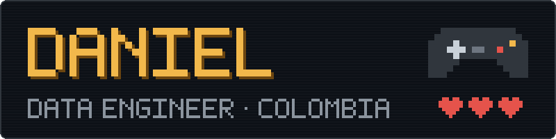

  

Hola, soy Daniel. Trabajo todos los días con Databricks y Python, y en el tiempo libre armo herramientas que me resuelven problemas reales: las del salón de mi pareja, las de mi casa y las de mi PC.

> ▸ **JUGADOR 1** · Ingeniero de datos senior  
> ▸ **MODO ACTUAL** · Armar herramientas que alguien sin código pueda usar  
> ▸ **FUERA DE TURNO** · Juegos retro y cacharrear hardware

Lo que más me gusta es que los datos queden ordenados y que los pipelines no se rompan en silencio.

## ▸ Con qué trabajo

Empecé automatizando tareas con Python y RPA, pasé por Azure y hoy construyo plataformas de datos en Databricks.

**Lakehouse y gobierno**
`Databricks` `Unity Catalog` `Delta Lake` `Arquitectura Medallion` `Genie Agents`

**Procesamiento y modelado**
`PySpark` `Spark SQL` `SQL Server` `Azure Synapse` `Parquet` `Modelado dimensional`

**Ingesta e integración**
`Azure Data Factory` `SHIR` `Logic Apps` `Azure Key Vault` `SAP` `Denodo` `APIs` `Excel`

**Lenguajes y librerías**
`Python` `SQL` `Bash` · Pandas, Scikit-learn, OpenCV, Requests

**BI y automatización**
`Power BI` `Power Automate`

**Entrega y control de versiones**
`Azure DevOps` `Git` `GitHub` `AWS`

**IA aplicada al desarrollo**
`Claude Code` `MCP` `Subagentes` `Spec-driven development` · Modelos locales con `Ollama` y `ROCm`

**Apps y herramientas propias**
`Flask` `Gradio` `EasyOCR` `PyInstaller`

### Cómo lo aplico

- Capas Bronze, Silver y Gold con contratos de granularidad entre ellas y manejo de vigencias en el tiempo.
- Calidad de datos con trazabilidad: cada regla que falla dice qué columna, qué registro y en qué capa.
- Validación de volúmenes y curvas históricas entre ambientes antes de pasar a producción.
- Accesos, linaje y metadatos gobernados desde Unity Catalog.
- Desarrollo asistido por IA con reglas y skills versionadas, y lo determinista resuelto en Python y shell, no en el modelo.

## ▸ Lo que tengo publicado

- [`telemetry-panel`](https://github.com/daniel9511/telemetry-panel): monitor en vivo del estado de mi PC con Windows (CPU, RAM, GPU, FPS y música), pensado para dejarlo corriendo en una tablet vieja de la red local. Python, Flask y JavaScript.

## ▸ Próximos niveles

Estoy puliendo estos para publicarlos con README, diagrama y datos de ejemplo:

- `medallion-pipeline-demo`: pipeline Bronze → Silver → Gold con PySpark y Delta sobre un dataset público, con pruebas y chequeos de calidad.
- `personal-manager-template`: cómo organizo mi vida con Notion como única fuente de verdad y Claude como intermediario, con niveles de autonomía y un manual de digitación. Todos los datos serán de ejemplo.
- `salon-agent`: skills para el cierre semanal y mensual de un negocio pequeño y para decidir con hechos y no con supuestos. Sin datos reales.
- `ocr-pdf-reader`: lector de PDFs escaneados con EasyOCR y Gradio, empaquetado como app de escritorio.

## ▸ Cómo trabajo

Prefiero tareas cortas y bien definidas, reglas escritas en vez de "ya sabrá", y que cada herramienta explique qué problema resuelve antes de mostrar el código. Si un repo mío no tiene README con diagrama y cómo correrlo, no está terminado.

## ▸ Si quieres hablar

Escríbeme por [LinkedIn](https://www.linkedin.com/in/william-daniel-cortes-875a50111/). Me interesa conversar sobre ingeniería de datos y sobre automatizar negocios pequeños.
